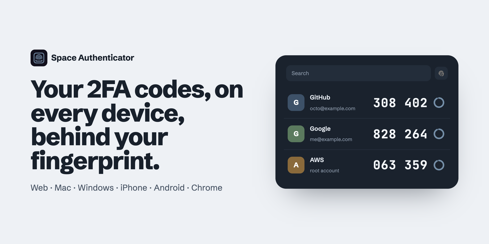

# Space Authenticator



Your 2FA codes, synced across web, desktop, mobile and a Chrome side panel, locked behind Touch ID / Face ID / fingerprint.

**Use it:** https://authenticator.sz4h.com · **Docs:** [user guide](https://mello21century.github.io/authenticator/docs/guide.html) · [self-hosting](https://mello21century.github.io/authenticator/docs/self-hosting.html)

**Download:**
[Mac (Apple silicon)](https://github.com/Mello21century/authenticator/releases/latest/download/Space-Authenticator-mac-arm64.dmg) ·
[Mac (Intel)](https://github.com/Mello21century/authenticator/releases/latest/download/Space-Authenticator-mac-x64.dmg) ·
[Windows](https://github.com/Mello21century/authenticator/releases/latest/download/Space-Authenticator-windows-setup.exe) ·
[Chrome extension](https://github.com/Mello21century/authenticator/releases/latest/download/Space-Authenticator-chrome-extension.zip)
(unzip, then chrome://extensions -> Developer mode -> Load unpacked) ·
[All releases](https://github.com/Mello21century/authenticator/releases)

**License:** source-available, not open source. You may read the code, use the official apps and run unmodified copies; modifying or redistributing it needs the owner's written approval. See [LICENSE](LICENSE).

##  How it works

Self-hosted 2FA authenticator: NestJS API (codes generated server-side, secrets AES-256-GCM encrypted in MongoDB), React web app, Electron desktop app, Expo mobile app.

```
apps/api        NestJS + Fastify + MongoDB
apps/web        Vite + React (also loaded by the desktop app)
apps/desktop    Electron (Touch ID lock on macOS)
apps/mobile     Expo / React Native (Face ID / fingerprint lock)
packages/shared API client, types, otpauth + importers, design tokens
```

##  Develop

```sh
pnpm install
cp .env.example .env   # fill VAULT_MASTER_KEY (openssl rand -base64 32) and JWT_SECRET
pnpm test              # all workspace tests (API tests use an in-memory MongoDB)
```

##  Deploy on Dokploy

1. Dokploy → Create service → **Compose** → provider GitHub → this repo, branch `main`, compose path `./docker-compose.yml`.
2. Environment (Dokploy writes it to `.env` next to the compose file):
   ```
   JWT_SECRET=<openssl rand -base64 48>
   VAULT_MASTER_KEY=<openssl rand -base64 32>   # back this up; losing it loses every secret
   RESEND_API_KEY=re_...
   MAIL_FROM=Authenticator <no-reply@your-domain>
   APP_URL=https://auth.your-domain
   SIGNUP_ENABLED=true
   CORS_ORIGINS=app://authenticator
   ```
3. Domains → add `auth.your-domain` → service **web**, port **80**, HTTPS on.
4. Enable auto deploy (webhook) so each push to `main` redeploys.

Local run of the same stack: `docker network create dokploy-network` once, then `docker compose -f docker-compose.yml -f docker-compose.local.yml up --build` → http://localhost:8080

##  Desktop (Electron)

```sh
pnpm --filter desktop dev                              # builds web + desktop, opens the app (API: http://localhost:8080/api)
AUTH_API_URL=https://auth.your-domain/api pnpm --filter desktop dist   # dmg / nsis / AppImage into apps/desktop/release
```
The server URL can also be changed on the login screen (Server). Add `app://authenticator` to `CORS_ORIGINS` on the API.
Signing: set `CSC_LINK`/`CSC_KEY_PASSWORD` (macOS Developer ID + notarization env) before `dist`.

##  Chrome extension (`apps/extension`)
Side panel with the same vault UI, locked behind Touch ID / Windows Hello (WebAuthn platform authenticator), password fallback.
- Build: `pnpm --filter extension build` -> `apps/extension/dist`
- Install for testing: `chrome://extensions` -> Developer mode -> **Load unpacked** -> pick `apps/extension/dist`
- Open: toolbar icon or **Cmd/Ctrl+Shift+2**; the search is pre-filled with the current site when a matching account exists.
- The `key` in `manifest.json` pins the ID to `dgmbchpaamaioijdcifhfjbbpkgkdadl` (allowed in the API's `CORS_ORIGINS`). `apps/extension/key.pem` is gitignored; keep a backup. A Chrome Web Store listing gets its own ID: add it to `CORS_ORIGINS`.

##  Logo
`design/logo/apply.sh [source.png]` regenerates every app icon from one 1024px image.

##  Mobile (Expo)

```sh
cd apps/mobile
npx expo run:ios            # simulator dev build (Face ID: Simulator > Features > Face ID > Enrolled)
npx expo run:android
npx eas-cli login           # once
npx eas-cli build -p all --profile production
npx eas-cli submit -p ios --profile production   # fill ascAppId in eas.json first
```
Set the production API URL in `eas.json` (`EXPO_PUBLIC_API_URL`). App ID everywhere: `com.sz4h.authenticator`.
